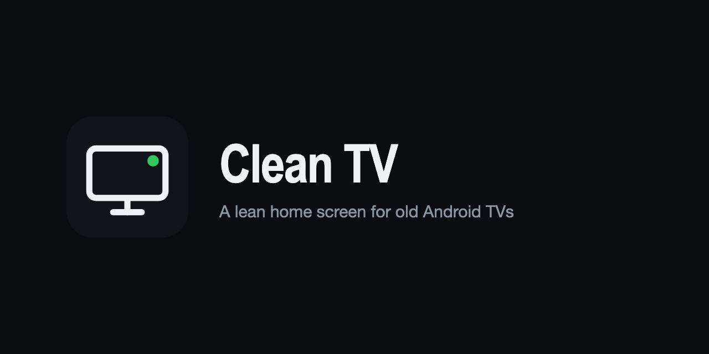

# Clean TV



A small, fast home screen for old Android TV sets. Built for a 2018 Mi TV 4A with 1 GB of RAM
that had become unusable under PatchWall and the Google launcher. No background services, no
recommendations, no accounts. Just inputs, channels, the apps you use, and a few tools.

Author: Mukul (mk24x7), https://mk24x7.com

## What it does

- Inputs panel with live state per HDMI port and AV. Ports with nothing plugged in collapse to one line.
- Boots straight into HDMI 1 (or the input you long-press to make default), so the set behaves like a monitor.
- Apps grid built from whatever is installed, using each app's own banner. Long-press OK to move or hide a tile.
- Channels: a built-in list of legal free live channels (public broadcasters' HLS streams and broadcasters' own
  YouTube live feeds). Drop your own `channels.m3u` at `/sdcard/CleanTV/channels.m3u` to replace it.
- Storage: every mounted USB drive gets a tile.
- Screensavers: Mystify, Starfield and Pipes, drawn on a plain canvas. Can be set as the system screensaver.
- Memory: live free RAM, OK to drop background apps, long-press for the maker's process manager when present.
- Send to TV: scan the code on the launcher with a phone or laptop, pick a video, a link or photos. The file
  stays on the phone and streams to the TV on demand; the page is the remote. Nothing is uploaded or stored.
- Remote keys: Home opens the launcher. The Mi button (a global key on Xiaomi sets) toggles between the
  launcher and what was playing; long-press starts the screensaver.

Idle after setup on the Mi TV 4A: about 450 MB free of 1 GB, CPU under 20 percent, every remote press under
150 ms. Third-party apps are still as heavy as they always were; the launcher cannot change that.

## Requirements

- Android TV 9 or later with ADB debugging enabled (Settings, Device Preferences, Developer options).
- A computer on the same network with `adb` installed.
- To build: JDK 17 and the Android SDK (platform 35, build-tools 35). Gradle downloads itself.

## Install

1. Build or download `app-debug.apk`:
   `./gradlew :app:assembleDebug`
2. Install and set as Home:
   `scripts/install.sh <tv-ip>`
3. Stop streaming apps from starting at boot and squatting in memory (they still open normally):
   `scripts/restrict-background.sh <tv-ip>`
4. Optional, Xiaomi sets only: freeze PatchWall, telemetry and the Google launcher so nothing restarts in the
   background. Everything it does is reversible:
   `scripts/freeze-xiaomi.sh <tv-ip>`
5. Reboot once. The TV should come up on HDMI 1 with Home and the Mi button working.

To go back to the stock launcher: `scripts/rollback.sh <tv-ip>`.

## How the key routing works

The remote's Mi button arrives as `KEYCODE_BUTTON_2` and is handled by the system's global key table, which
points at a Xiaomi receiver that starts PatchWall by component name. It cannot be re-pointed. Clean TV
registers a key-filtering accessibility service that sees the key before the global handler on Android 9 and
consumes it. Input switching uses the standard TV input framework passthrough URI, played by the Live TV app
that ships with the set, so no Xiaomi code is involved.

Both facts were verified on `Xiaomi/magnolia` (Mi TV 4A 32, Amlogic T962, Android 9 build 3698). On other
sets the key code and the passthrough player may differ. `adb logcat | grep interceptKeyTq` shows the key
code of any button.

## Signing your own build

Create `keystore.properties` in the project root (it is ignored by git):

```
storeFile=keystore/your.jks
storePassword=...
keyAlias=...
keyPassword=...
```

Without it, builds use the Android debug key, which is fine for sideloading on your own set.

## Layout of the code

- `app/src/main/java/app/cleantv/` home screen, key filter, data layers for inputs, apps, storage, memory.
- `.../channels/` M3U parser, store and the channels player.
- `.../saver/` the three screensavers, dream service and chooser.
- `.../sendtotv/` the HTTP and WebSocket server, range proxy, QR encoder and remote player.
- `app/src/main/assets/` the bundled channel list and the Send to TV web page.
- `design/` the HTML prototypes the layout was chosen from.

## Licence

MIT. See LICENSE.
