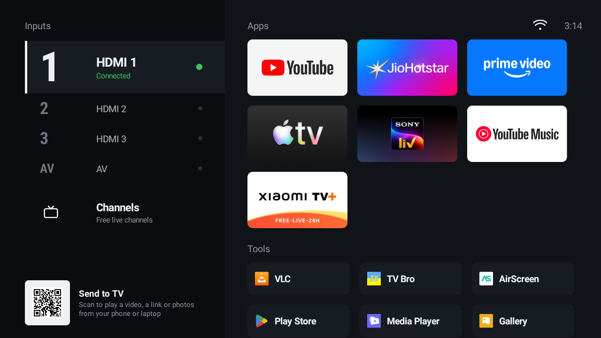
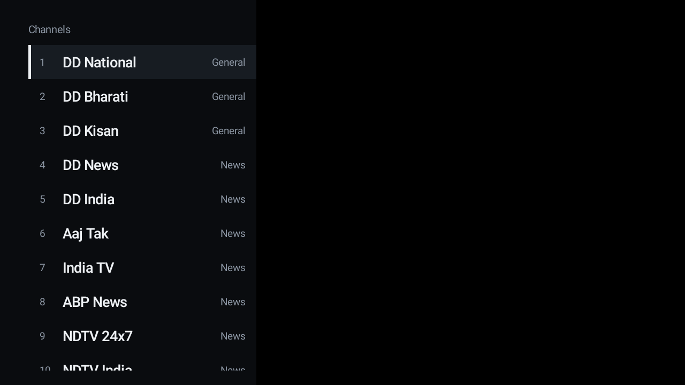
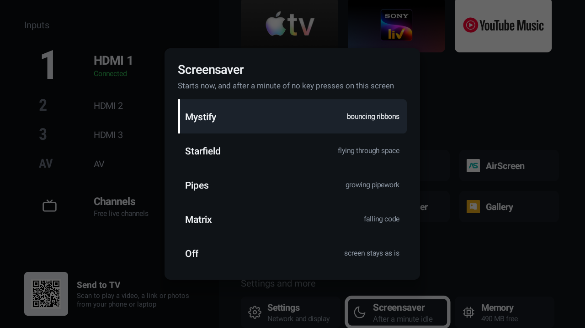
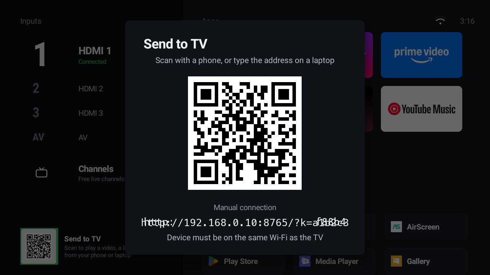
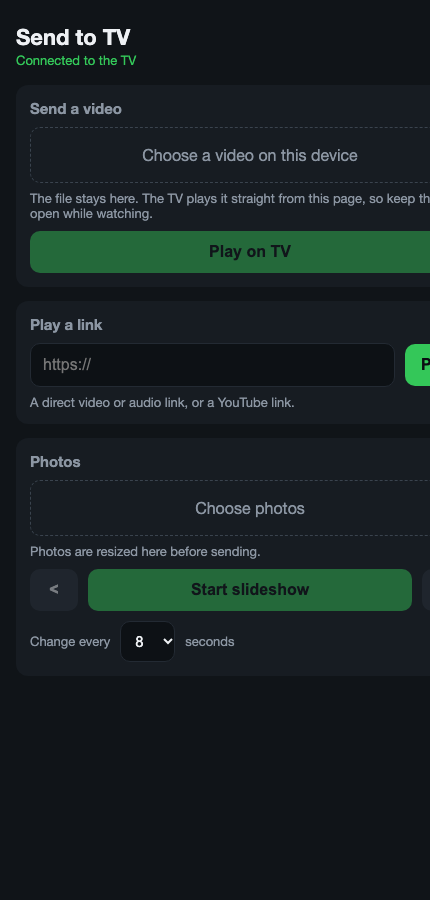
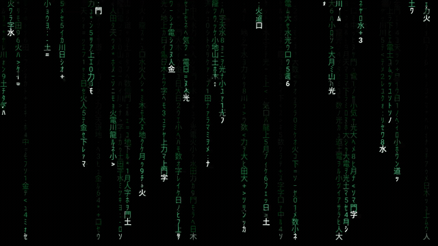

# Clean TV

A small, fast home screen for old Android TV sets. Built for a 2018 Mi TV 4A with 1 GB of RAM that had
become unusable under PatchWall and the Google launcher. No background services, no recommendations, no
accounts. Inputs, free channels, the apps you use, a few tools, and a way to send media from your phone.

Author: Mukul (mk24x7), https://mk24x7.com. MIT licence.

## What it does

- **Inputs** with live state per HDMI port and AV. Ports with nothing plugged in collapse to one line.
  Long-press a port to make it the start-up input. The TV boots straight into it, so the set behaves
  like a monitor.
- **Channels**: a built-in list of legal free live channels, public broadcasters' HLS streams and
  broadcasters' own YouTube live feeds, grouped by News, World, Science, Music, Kids and more. Drop your
  own `channels.m3u` at `/sdcard/CleanTV/channels.m3u` to replace it.
- **Apps** grid built from whatever is installed, using each app's own banner. Long-press OK to move or
  hide a tile. Utilities such as VLC, a browser and the Play Store sit in a compact Tools row.
- **Storage**: every mounted USB drive gets a tile.
- **Screensavers**: Matrix, Mystify, Starfield and Pipes, drawn on a plain canvas. They start after a
  chosen idle time (1 to 15 minutes) without key presses on the launcher only, never over HDMI or
  inside an app. A long press of the Mi button starts one on demand.
- **Memory**: live free RAM. OK drops background apps; long-press opens the maker's process manager when
  the set has one. Thirty seconds after the launcher appears, apps still sitting in the background are
  dropped, so an accidental Home press does not kill what you were watching.
- **Send to TV**: focus the code on the launcher and press OK for a large version with the typed address.
  Open it on a phone or laptop, pick a video, a link or photos. The file stays on your device and streams
  to the TV on demand; the page is the remote. Nothing is uploaded or stored.
- **Remote keys**: Home opens the launcher. The Mi button, a global key on Xiaomi sets, toggles between
  the launcher and whatever was playing; a long press starts the screensaver.

Measured on the Mi TV 4A after setup: about 450 MB free of 1 GB at idle, CPU under 20 percent, every
remote press under 150 ms. Third-party apps are as heavy as they always were; a launcher cannot change
that.

## Screenshots

| Channels | Screensaver chooser |
|---|---|
|  |  |

| Send to TV on the launcher | The page on a phone |
|---|---|
|  |  |

Screensavers, recorded on the TV:

| Matrix | Mystify |
|---|---|
|  |  |

| Starfield | Pipes |
|---|---|
|  |  |

## Requirements

- Android TV 9 or later with ADB debugging on (Settings, Device Preferences, Developer options; tap
  Build seven times under About to reveal it).
- A computer on the same network with `adb` installed (`brew install android-platform-tools` on a Mac).
- To build from source: JDK 17 and the Android SDK with platform 35 and build-tools 35. Gradle
  downloads itself.

## Install

1. Download `cleantv-release.apk` from the [releases page](https://github.com/mk24x7/cleantv/releases), or build it:

       ./gradlew :app:assembleDebug

2. Install and set as Home (replace the address with your TV's):

       scripts/install.sh 192.168.0.10

3. Stop streaming apps from starting at boot and squatting in memory. They still open normally:

       scripts/restrict-background.sh 192.168.0.10

4. Xiaomi sets only, optional: freeze PatchWall, telemetry and the Google launcher so nothing restarts in
   the background. Everything it does is reversible:

       scripts/freeze-xiaomi.sh 192.168.0.10

5. Reboot once. The TV should come up on HDMI 1 with Home and the Mi button working.

Updating later: install the new APK with `adb install -r` and open the launcher once. It re-registers its
key filter by itself.

To go back to the stock launcher: `scripts/rollback.sh 192.168.0.10`.

## Using it

- Up and down move through inputs, right moves into apps. OK opens, long-press OK for the tile menu.
- Back from the launcher returns to whatever was playing.
- In Channels, Enter tunes, up and down change channel while the list is hidden, left or OK brings the
  list back, Back on the list exits.
- Phone as keyboard and touchpad: install the Google TV app on your phone; the TV's remote service is
  already running and pairs over Wi-Fi. This makes the browser and search boxes usable.

## How the key routing works

The remote's Mi button arrives as `KEYCODE_BUTTON_2` and is handled by the system's global key table,
which points at a Xiaomi receiver that starts PatchWall by component name. It cannot be re-pointed.
Clean TV registers a key-filtering accessibility service that sees the key before the global handler on
Android 9 and consumes it. Input switching uses the standard TV input framework passthrough URI, played
by the Live TV app that ships with the set, so no Xiaomi code is involved.

Both facts were verified on `Xiaomi/magnolia` (Mi TV 4A 32, Amlogic T962, Android 9 build 3698). On
other sets the key code and the passthrough player may differ. `adb logcat | grep interceptKeyTq` shows
the key code of any button.

## Questions people ask

**Netflix?** The Play Store refuses it on sets Netflix no longer certifies, and sideloaded builds get
blocked within weeks. Cast from the Netflix phone app to the TV's built-in Chromecast, or plug a stick
into HDMI 1.

**Apple TV and Apple Music?** The Apple TV app installs from the store on this set. Apple Music does not;
use AirPlay through a receiver app such as AirScreen, or cast from the Android app.

**Why not a memory cleaner on a timer?** Android already treats cached apps as free memory and evicts
them in milliseconds when needed. Killing them early makes every next launch a cold start. The real fix
is stopping apps from waking up at boot, which `restrict-background.sh` does.

**Why not root?** Nothing here needs it, there is no custom recovery for these panels, and a bad flash
is a dead TV.

**The screen is black after a reboot.** The launcher is not Home. Run `scripts/install.sh` again, or
restore the stock launcher with `scripts/rollback.sh`.

## Signing your own build

Create `keystore.properties` in the project root (ignored by git):

    storeFile=keystore/your.jks
    storePassword=...
    keyAlias=...
    keyPassword=...

Without it, builds use the Android debug key, which is fine for sideloading on your own set.

## Layout of the code

- `app/src/main/java/app/cleantv/` home screen, key filter, data layers for inputs, apps, storage, memory.
- `.../channels/` M3U parser, store and the channels player.
- `.../saver/` the four screensavers, dream service and chooser.
- `.../sendtotv/` the HTTP and WebSocket server, range proxy, QR encoder, dialog and remote player.
- `app/src/main/assets/` the bundled channel list and the Send to TV web page.
- `design/` the HTML prototypes the layout was chosen from.
- `scripts/` install, restrict, freeze and rollback helpers.
- `art/` logo and banner.
